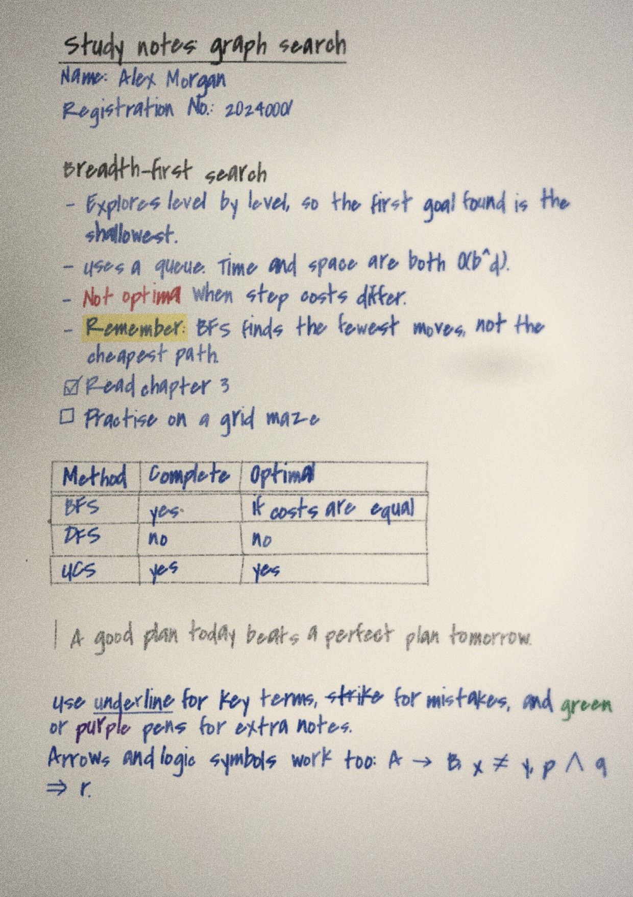

# Handwriting

Browser tool that turns typed text into realistic handwritten A4 pages. No server model, no GPU.

**Use it: [write.deepanalve.dev](https://write.deepanalve.dev)**



## Run

```bash
python3 serve.py
```

Open http://localhost:8765/. `serve.py` is a static server with a save endpoint. `python3 -m http.server 8765` also works.

## How to use it

The panel has an icon rail with five tabs. Zoom, seed, Shuffle, PNG and PDF sit in a dock over the pages.

- **Write**: type or paste text. The toolbar adds markdown. The colour dots wrap the selection in a pen colour. "Writing syntax" lists every code.
- **Ink**: choose which pen writes body text, bold, headings, subheadings, table lines, table headers and quotes. Choose the highlighter colour.
- **Hand**: ready made looks, 21 handwriting fonts as cards, size, slant, and realism sliders.
- **Paper**: plain, ruled, grid, dots, legal pad or aged. Spacing and margins.
- **Camera**: scan and photo looks. Each card shows your own first page shot that way.

Export one A4 PDF or a PNG per page. The same seed and text give the same page. Shuffle gives a new take.

## Text markup

| Write | Result |
| --- | --- |
| `# Heading` | Larger, underlined, heading pen |
| `## Subheading` | Heading pen, no underline |
| `**bold**` | Pressed harder |
| `*italic*` | Leans over |
| `==mark==` | Highlighter |
| `__under__`, `~~strike~~` | Line under, line through |
| `{red}text{/}` | Any pen colour: `red blue black green purple pencil gel bluegel felt fountain` |
| `` `note` `` | Pencil |
| `- item`, `  - sub`, `1. item` | Hanging bullets and numbers |
| `- [ ] task`, `- [x] done` | Hand drawn boxes |
| `> quote` | Pencil, bar at the left |
| `\| a \| b \|` then `\|---\|---\|` | Hand drawn table. The row above the divider is the header |
| `---` | Hand drawn line |
| `\newpage` | Start a new page |

`samples/demo.txt` produces the page above.

## Camera looks

Close-up angle, Far on desk, Flash photo, Dim room, Scanner app, Photocopy, Mixed by page, plus Clean, Flatbed scan and Phone photo. "How bad the camera is" scales keystone, paper bow, glare, soft focus and grain. The close and flash looks add a crease, specks and a smudge.

## What else it does

- Every letter outline is warped, so no two letters match. Per letter and per word variation, baseline wander, line tilt, pressure and fatigue.
- Pens: ballpoint, gel, fountain, felt, pencil, red, green, purple.
- Hand drawn symbols the fonts lack: `→ ⇒ ∀ ∃ ∧ ∨ ¬ ≠ ≤ ≥ ∞ α β Δ × ✓ ✗ ☐ ☑`.
- Your own font file works too.

## Files

- `app.js`: layout, markup, paper, ink, camera, panel, export.
- `index.html`, `style.css`: the panel, the desk and the export dock.
- `fonts/ui/`: panel fonts (Space Grotesk, Inter, JetBrains Mono).
- `fonts/`: `.woff2` for display, `.woff` for outline parsing.
- `opentype.min.js`: outline parser (opentype.js 1.3.4).
- `FONTS.md`: font licences.
- `assets/`: icon and social preview image. `robots.txt`, `sitemap.xml`: for search engines.
- `Dockerfile`, `deploy/`: nginx image for hosting.

## Self-host

The site is static. The `Dockerfile` serves it with nginx:

```bash
docker build -t handwriting .
docker run -p 8080:80 handwriting
```

## Licence

MIT for the code. Fonts keep their own licences, see `FONTS.md`.
